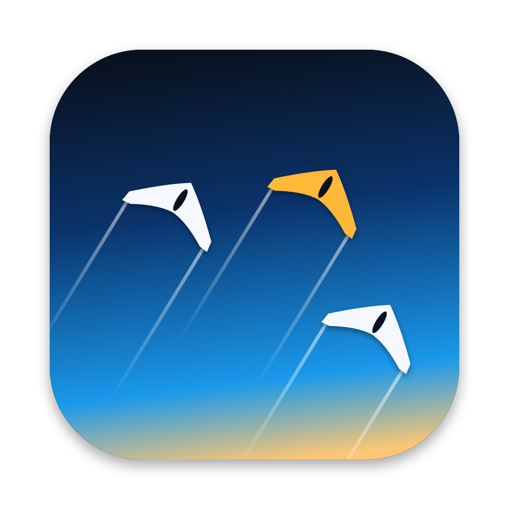
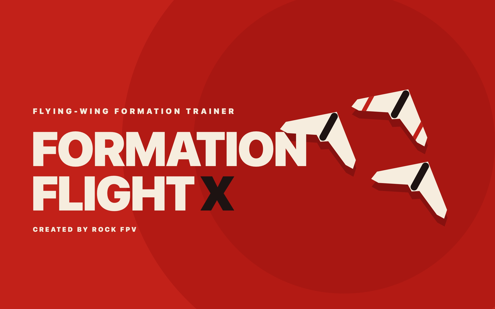

# FormationFlightX

A formation flight trainer for RC flying wings on macOS, written in Swift and rendered with Metal. Up to three pilots fly together, on one network or over the internet, with no server. Created by Rock FPV.



FormationFlightX is built on [FlightCore OSX](https://github.com/lydianb79/FlightCoreOSX): the flight physics, the eleven flying wings, the twenty 3D flying sites, the weather, the sound and the renderer come from there unchanged. What is new is everything about flying together.

## Build and run

Requirements: macOS 13 or later, a Mac with Metal support, and Xcode 15 or later (or the Swift 5.9+ command-line toolchain).

```bash
./build_app.sh
```

```bash
open FormationFlightX.app
```

Run the app bundle rather than the bare binary when you want multiplayer: macOS only lets an app with the right entries in its `Info.plist` search the local network, and `build_app.sh` writes them. The first launch asks for permission to find devices on the local network; say yes, or allow it later under **System Settings ▸ Privacy & Security ▸ Local Network**.

## Flying together

There is no server, no account and no host. Every copy of the app announces itself on the local network with Bonjour and looks for the others; each pilot then sends their wing's position straight to the others over UDP, sixty times a second. Macs on the same Wi-Fi or cable network find each other by themselves, and so do Macs with Wi-Fi on but no shared network, over Apple's peer-to-peer Wi-Fi.

- **Three pilots at most.** A fourth copy on the network is ignored by the first three.
- **Groups.** Pilots with the same group name (Formation panel) fly together, so two formations can share one network. An empty group flies with anyone.
- **The lead decides.** The flying site, weather, time of day, formation and spacing of the lead apply to everyone, within half a second.
- **Who leads.** Until someone claims it, the pilot whose copy has the lowest network number leads. Press **U** (or **Take the Lead**) to claim the lead; press it again to hand it back.
- **Mid-air collisions** end the flight for both wings. You are put back behind your slot a few seconds later.
- A pilot who opens a menu stops being shown to the others until they fly again.

### On the same network

Nothing to set up: Macs on the same Wi-Fi or cable network find each other by themselves, and so do Macs with Wi-Fi on but no shared network, over Apple's peer-to-peer Wi-Fi.

### Over the internet

One pilot hosts and the others connect to the host. There is still no server: the host's copy of the app passes each pilot's positions on to the others.

1. **The host** opens the Formation panel and switches on **Host**. The app asks the router to open UDP port 47800 (NAT-PMP, PCP or UPnP) and then shows the address to give out, for example `203.0.113.5:47800`.
2. **The others** type that address under **Or join a host** and press **Connect**. The panel says when the host is answering.

If the router does not open the port by itself, the panel says so: forward UDP port 47800 to the host's Mac in the router's settings and give the others your public address followed by `:47800`. A host name works as well as a number. If the internet provider shares one public address between customers (carrier-grade NAT), that connection cannot host; let someone else host, or put the Macs on one virtual network (ZeroTier, Tailscale) and join the host's address there.

Who hosts has nothing to do with who leads: any pilot can take the lead. Pilots on the host's own network join in by themselves and fly with the online ones. Everyone's traffic to an online pilot goes by way of the host, so the host's connection sets the delay.

Anyone who knows the address can connect while hosting is on. Set a group name to keep strangers out of the formation, and switch hosting off afterwards; that also closes the port on the router.

## Flying alone

While no other pilot is connected, two computer-flown wings fill the formation (turn them off with **G**). They fly the same wing as you, so everyone has the same speed range.

- By default the computer leads round a wide racetrack about 38 m above the field, and you fly number 2 with another computer wing as number 3.
- Press **U** to take the lead: both computer wings then hold their slots on you.
- **K** hands your own wing to the autopilot, which flies whatever part you have: the racetrack if you lead, your slot if you do not.

Measured over 150 seconds of racetrack with each of the eleven wings (`--formtest`), the computer wingmen hold their slots to between 0.6 m and 2.8 m RMS, turns included, both behind a computer lead and behind your own wing on its autopilot after a hand launch. None of them crashes. The computer lead turns wider the wider the formation is, so the wingman on the inside of a turn keeps flying speed.

## Holding your slot

- A **ring** in the air marks your slot: amber while you are off station, green when you are in it.
- The **formation box** (top left) shows your number, the formation, every other wing's distance, and how far you are from your slot. The little scope beside it is a top view with your wing in the middle and the slot as a circle; the bar on its right is the height difference.
- **On station** counts the share of your flying time spent inside the slot. The lead sees how far each wingman is off their slot instead.
- **J** puts you in the air a little behind your slot at the lead's speed, so you can practise the last part of a join-up again and again. **Space** starts with a hand launch from the pilots' position.

Formations: vic, echelon right, echelon left, line astern, line abreast. Spacing: tight, normal or loose, which is 1.5, 2.5 or 5 wingspans of the lead's wing between neighbours.

## Keys

| Key | |
|---|---|
| ← → ↑ ↓ | Roll and pitch (↓ pulls up) |
| W S, X | Throttle up and down, throttle cut |
| J | Join up behind your slot |
| U | Take the lead / hand it back |
| O, I | Next formation, next spacing (lead only) |
| G | Computer partners on / off |
| C | Camera: chase, onboard, pilot on the ground |
| Y | Smoke (the others see it too) |
| Space | Start again with a hand launch |
| Esc, Tab | Main menu, wing browser |

**H** in the app lists the rest. Gamepads and USB RC transmitters work as in FlightCore OSX (Controller Setup, ⌘,).

## What is in the source

| File | |
|---|---|
| `Net.swift` | Bonjour discovery, UDP transport and the two message types |
| `Formation.swift` | Formation shapes and slots, smoothing of network pilots, the computer pilot |
| `FormationGame.swift` | Roster, lead, slots, collisions, what is sent and shown |
| everything else | FlightCore OSX, limited to flying wings and 3D sites |

Command-line checks: `--formtest` flies the computer partners with every wing and prints how well they hold formation; `--formtrace <wing> <0|1>` prints one flight in detail; `--net --netlog --name <name>` runs a windowed copy that logs who it sees; add `--host`, or `--join <address>`, and `--nobonjour` to try the online path on one Mac.

## Not yet done

- Tested with copies on one Mac only: local discovery with two copies, and a host with two joiners (local discovery switched off, so everything went by way of the host). Separate Macs, peer-to-peer Wi-Fi and a real internet path with its delay have not been tried, and the router on the test network did not open the port by itself, so the automatic port opening has only been seen to fail politely.
- Positions are predicted forward to cover network delay; this suits a local network, and has not been tuned for the 50 to 150 ms of an internet path.
- The other wings make no sound, cast no shadow on the ground beyond 14 m from yours, and do not break apart when they crash.
- No wake turbulence behind another wing.
- `main.swift` still carries FlightCore's test commands, several of which name aircraft that are no longer in the library.

## License

GPL-3.0, as FlightCore OSX. See `LICENSE`.
