# FormationFlightX

**Fly together.** A formation flight trainer for RC aircraft on macOS, written in Swift and rendered with Metal. Up to five pilots fly together, on one network or over the internet, with no server; alone, computer partners fill the formation. Created by Rock FPV.

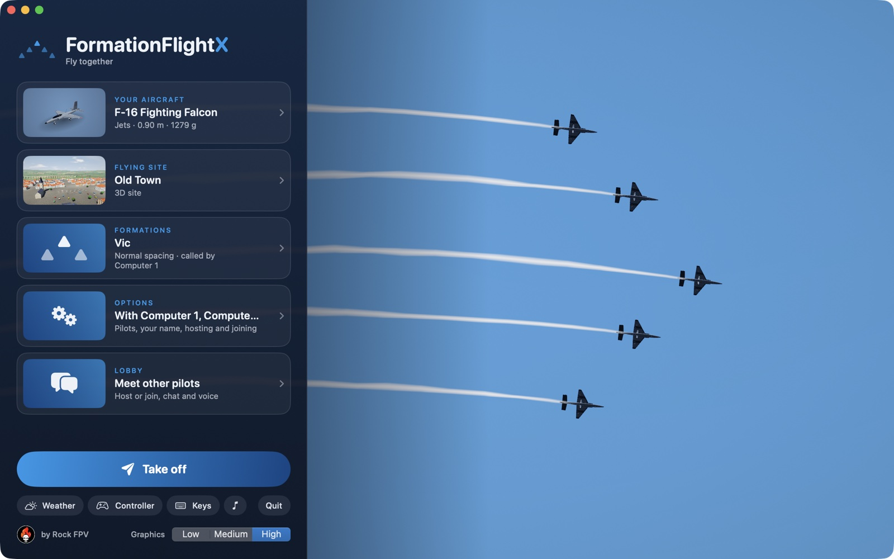

| | |
|---|---|
| 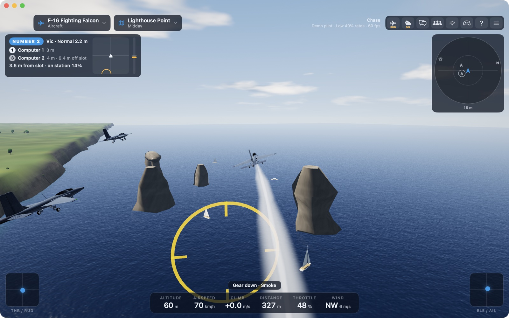 | 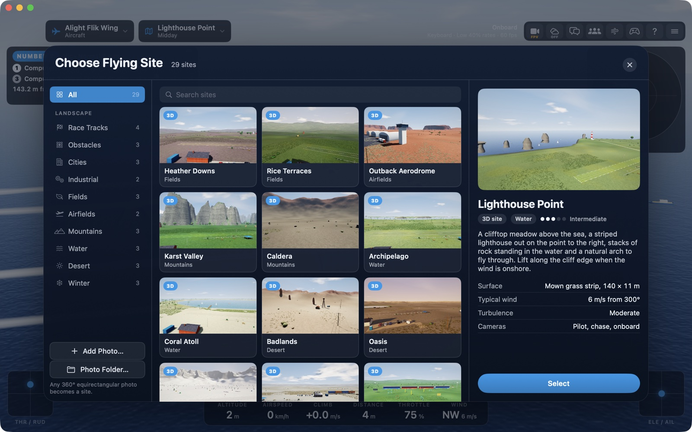 |
| 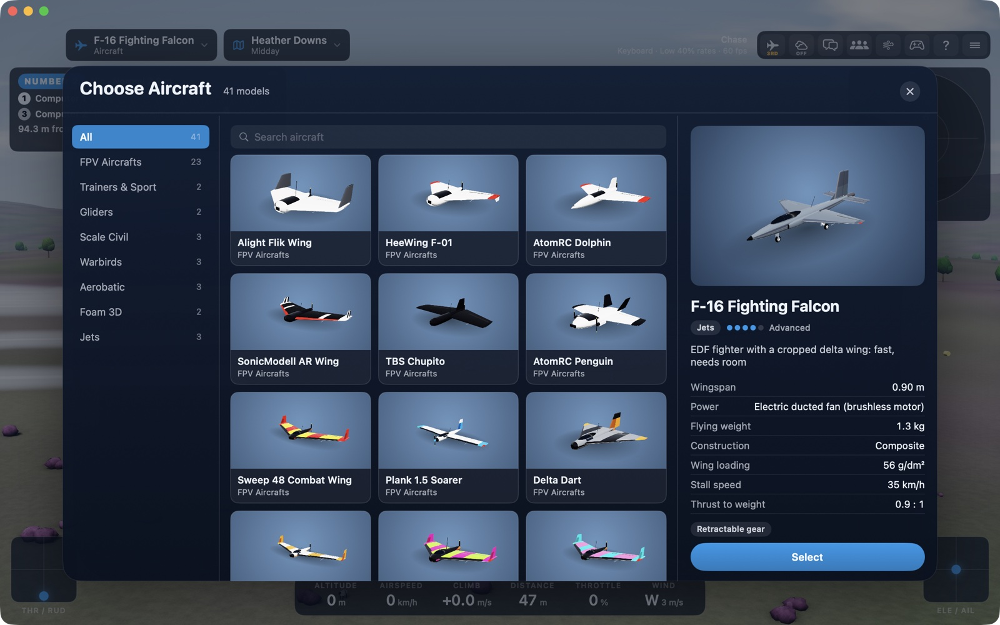 | 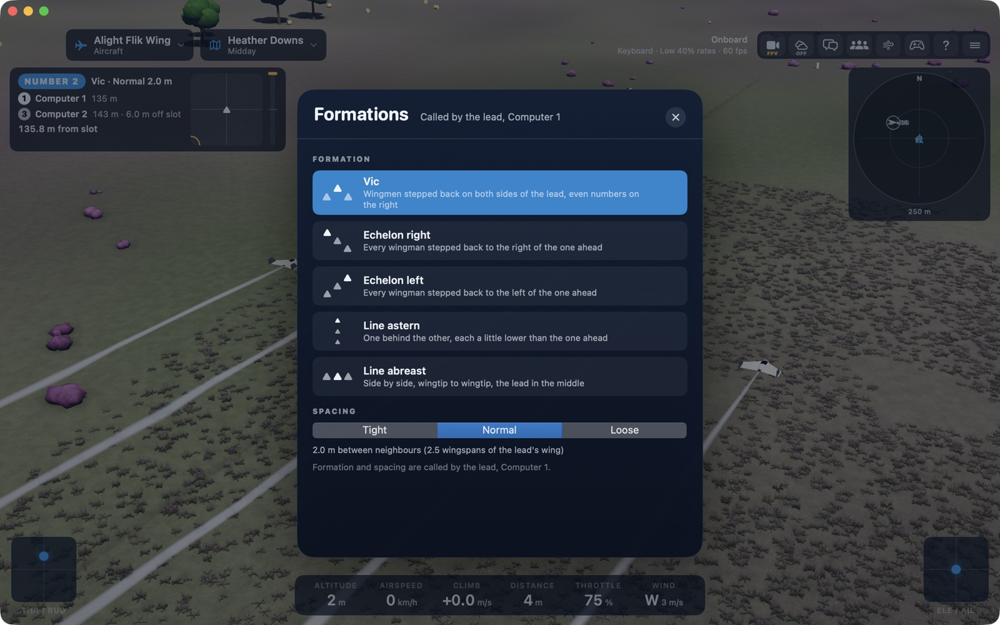 |

- **41 aircraft**, 23 of them FPV wings and planes, 12 of those modelled on ones you can buy.
- **29 flying sites** in ten kinds: race tracks, obstacle courses, cities, industrial, fields, airfields, mountains, water, desert, winter.
- **Five formations**, three spacings, a ring in the air that marks your slot and a score for how well you hold it.
- **Up to five pilots**, found automatically on a local network or joined over the internet through one pilot who hosts; a lobby with chat and voice.
- **Computer partners** that lead or follow with every aircraft.

A few of the sites:

| | | |
|---|---|---|
| 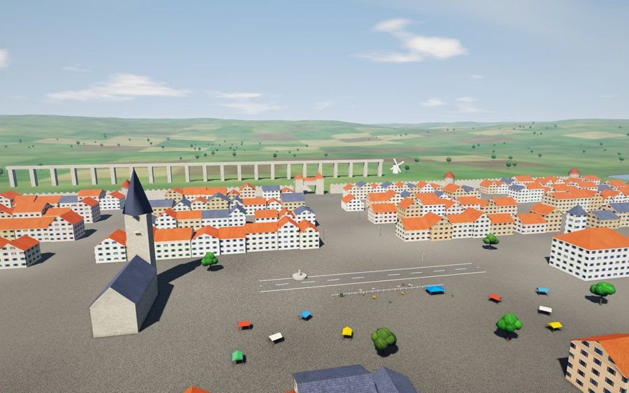 | 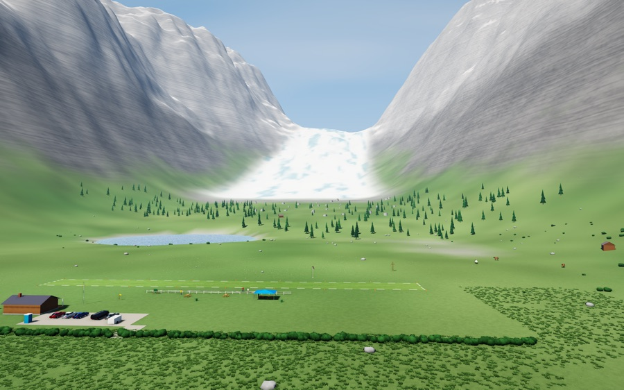 | 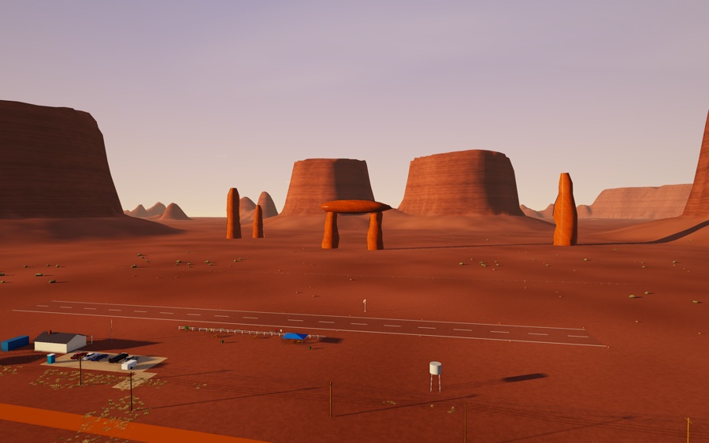 |
| 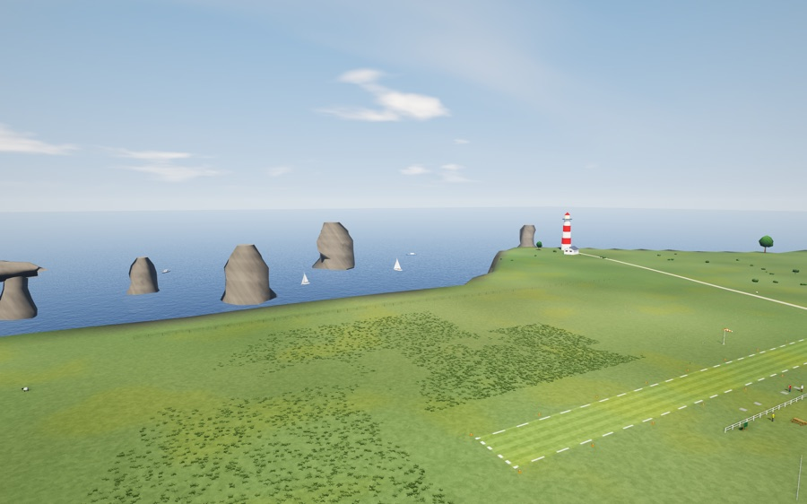 | 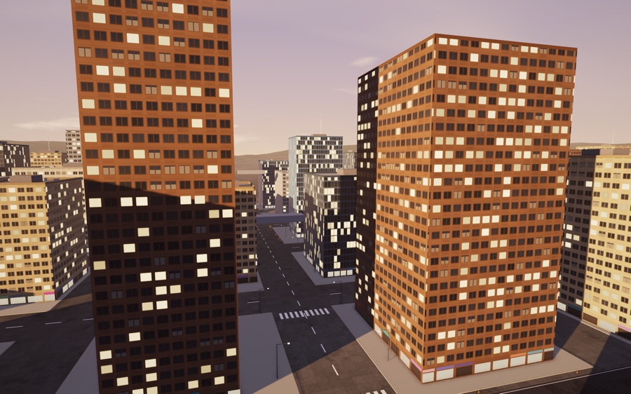 | 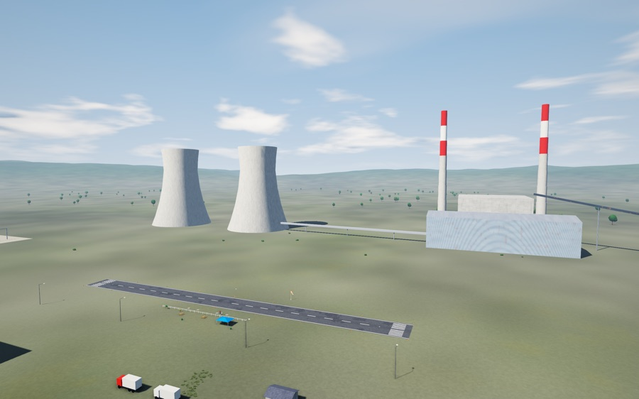 |

FormationFlightX is built on [FlightCore OSX](https://github.com/lydianb79/FlightCoreOSX): the flight physics, most of the aircraft, the weather, the sound and the renderer come from there. The flying sites, the FPV aircraft, the menu music, the look and everything about flying together are its own.

## Download

Ready-built apps are on the [Releases](https://github.com/lydianb79/FormationFlightX/releases) page: one zip for Apple silicon Macs, one for Intel Macs. Unzip and open `FormationFlightX.app`. The app is not signed with an Apple developer certificate, so the first time macOS will refuse to open it: right-click the app and choose **Open**, or allow it under **System Settings ▸ Privacy & Security**.

## Build and run

Requirements: macOS 13 or later, a Mac with Metal support, and Xcode 15 or later (or the Swift 5.9+ command-line toolchain).

```bash
./build_app.sh
```

```bash
open FormationFlightX.app
```

`./build_release.sh` builds the two release zips into `dist/`.

Run the app bundle rather than the bare binary when you want multiplayer: macOS only lets an app with the right entries in its `Info.plist` search the local network, and `build_app.sh` writes them. The first launch asks for permission to find devices on the local network; say yes, or allow it later under **System Settings ▸ Privacy & Security ▸ Local Network**.

## Flying together

There is no server and no account. Every copy of the app announces itself on the local network with Bonjour and looks for the others; each pilot then sends their aircraft's position straight to the others over UDP, sixty times a second. Macs on the same Wi-Fi or cable network find each other by themselves, and so do Macs with Wi-Fi on but no shared network, over Apple's peer-to-peer Wi-Fi.

- **Five pilots at most.** Each copy flies with the first four others it meets and ignores any more.
- **Groups.** Pilots with the same group name (Options) fly together, so two formations can share one network. An empty group flies with anyone.
- **The host runs the session** (see below): where it flies, the weather and daylight, and when it starts and stops.
- **The lead calls the formation.** Formation and spacing are the lead's. Until someone claims the lead, the pilot whose copy has the lowest network number leads. Press **U** (or **Take the Lead**) to claim it; press it again to hand it back.
- **All copies need the same version.** This version's messages are not understood by earlier builds.
- **Mid-air collisions** end the flight for both wings. You are put back behind your slot a few seconds later.
- A pilot who opens a menu stops being shown to the others until they fly again.

### On the same network

Nothing to set up: Macs on the same Wi-Fi or cable network find each other by themselves, and so do Macs with Wi-Fi on but no shared network, over Apple's peer-to-peer Wi-Fi.

### Over the internet

One pilot hosts and the others connect to the host. There is still no server: the host's copy of the app passes each pilot's positions on to the others.

1. **The host** opens **Options** and switches on **Host a session**. It then shows **your public address**, for example `203.0.113.5:47800`, with a Copy button; the lobby shows it too. The app also asks the router to open UDP port 47800 (NAT-PMP, PCP or UPnP) and says whether it did.
2. **The others** type that address under **Or join a host** and press **Connect**. The panel says when the host is answering.

If the router does not open the port by itself, the panel says so, in amber under the address: forward UDP port 47800 to the host's Mac in the router's settings (the panel gives the Mac's address on your network). The public address shown is right either way, but nobody outside gets through until the port is open.

The public address comes from the router when it opens the port. Otherwise the app asks a public "what is my address" service (api.ipify.org, then checkip.amazonaws.com, then icanhazip.com); this happens only while hosting is on, and it is the one thing the app ever asks of anyone outside the formation. The address is shown in Options and the lobby, not on the flight screen, so it does not end up in a stream or a screenshot by accident. A host name works as well as a number. If the internet provider shares one public address between customers (carrier-grade NAT), that connection cannot host; let someone else host, or put the Macs on one virtual network (ZeroTier, Tailscale) and join the host's address there.

Who hosts has nothing to do with who leads: any pilot can take the lead. Pilots on the host's own network join in by themselves and fly with the online ones. Everyone's traffic to an online pilot goes by way of the host, so the host's connection sets the delay.

Anyone who knows the address can connect while hosting is on. Set a group name to keep strangers out of the formation, and switch hosting off afterwards; that also closes the port on the router.

## Aircraft

Forty-one fixed-wing aircraft; there are no helicopters or multirotors. The **FPV Aircrafts** category holds every flying wing and FPV plane, twenty-three in all; they come first, and the app opens on one.

**FPV aircraft you can buy**, modelled from their published span, flying weight and wing area. Power, propeller and drag are set so that the simulated aircraft stalls, cruises and tops out where the real one is reported to (speeds in km/h, as measured by `--flighttest` in still air):

| Aircraft | Category | Span | Weight | Stall | Half throttle | Flat out |
|---|---|---|---|---|---|---|
| Alight Flik Wing | FPV Aircrafts | 0.50 m | 235 g | 31 | 44 | 83 |
| HeeWing F-01 | FPV Aircrafts | 0.69 m | 500 g | 37 | 60 | 110 |
| AtomRC Dolphin | FPV Aircrafts | 0.85 m | 620 g | 36 | 54 | 101 |
| SonicModell AR Wing | FPV Aircrafts | 0.90 m | 620 g | 35 | 53 | 98 |
| TBS Chupito | FPV Aircrafts | 0.80 m | 650 g | 40 | 134 | 222 |
| AtomRC Penguin | FPV Aircrafts | 0.75 m | 680 g | 40 | 47 | 91 |
| HeeWing T1 Ranger | FPV Aircrafts | 0.73 m | 480 g | 29 | 43 | 83 |
| HeeWing T2 Cruza | FPV Aircrafts | 1.20 m | 1900 g | 38 | 52 | 100 |
| HeeWing H1 Hunter | FPV Aircrafts | 0.68 m | 245 g | 22 | 33 | 63 |
| ZOHD Altus | FPV Aircrafts | 0.98 m | 920 g | 32 | 46 | 88 |
| AtomRC Swordfish | FPV Aircrafts | 1.20 m | 1150 g | 39 | 54 | 101 |
| ZOHD Drift | FPV Aircrafts | 0.88 m | 265 g | 22 | 31 | 59 |

What these are and are not:

- The **figures** are the makers' and retailers': span, flying weight, wing area where given, motor size, and for the Chupito the published stall, cruise and top speeds. Where sources disagree (the Dolphin's weight, the Flik's span) a middle value is used. For the others the speeds are what pilots usually report for aircraft of that size and power, not measurements of mine.
- The **shapes** are built from photographs of the real aircraft: the Flik's large dark winglets, the F-01's down-turned red tips, the Dolphin's long pointed nose and single fin, the AR Wing in black with a red leading edge, white bands and chequered fins, the black forward-swept Chupito with its fin on the body, the Penguin's wide lifting body with two motors and two leaning fins, the grey T1 Ranger and T2 Cruza as a pod on a thin boom with a tall fin, the Altus and Swordfish with their V-tails, the Hunter's tube fuselage and red dashes, and the Drift with its motor on a pylon behind the wing. They are made from simple generated shapes: wings are straight-tapered, bodies are not blended into the wing, and there are no printed graphics. V-tails are drawn as V-tails but fly as the plain tail of the same size.
- The Penguin is modelled as the tailless lifting body it is, and with its small listed wing area stalls at about 40 km/h.
- Each is trimmed in pitch for a gentle cruise (37 to 60 km/h) and in roll against its propeller's torque, as you would on the first flights, so it flies straight with the sticks let go.
- **Pitch trim follows the speed, and the throttle.** A model trimmed for a gentle cruise noses up hard when it goes fast. Every powered aircraft now has that trimmed out, as a transmitter mix would: calibrated from level runs on half and on full throttle, it holds the aircraft level at any speed with the stick centred, and acts from the moment of the throw, as fast as a servo. On top of that a throttle-to-elevator mix cancels what the motor's own thrust does to the pitch (a motor on a pylon pushes the nose down). The result flies where it is pointed: open the throttle and it goes faster, not up. A climb is kept, not steepened, until you push. `--powertest` measures it, `--pitchtrace <aircraft>` follows one through a throw and throttle changes, hands off. `--spintrace <aircraft>` follows a spin and `--rolltrace <aircraft>` a torque roll, with the moment of each surface.
- **Launching.** A hand-launched aircraft stays in your hand, motor running, until you press **Launch**: Space, the right shoulder button of a gamepad, or a transmitter switch assigned to Launch in Controller Setup. The computer pilots beside you throw theirs at the same moment. On the autopilot the aircraft throws itself.
- **Trim gauge.** Under the map: the pitch trim in clicks, laid out as the elevator trim on a transmitter: the arrow above trims nose down, the one below nose up, and the marker moves the same way.
- None of them has a flight controller: no stabilisation, no return to home.

**The 3D foamies** (Foam Extra XL, Shock Flyer 800) are built 0–0, wing and tailplane at zero incidence, as their builders set them up: neutral, so they fly the same upright and inverted and hang without wanting to go anywhere. They get no cruise trim and no speed trim; with the stick centred they settle at about 30 and 18 km/h. Their fin and rudder run as far below the fuselage line as above it, as real profile planes are cut. So rolling in a hover (a torque roll) no longer swings the nose over: with full aileron and the rudder and elevator left alone, the Foam Extra XL is 3° off vertical after half a second, where it was 15°, and a pilot holding the hover needs 1% rudder instead of 6%. The rudder no longer rolls them either, which helps in knife-edge. Their sticks are set up as 3D pilots set theirs: 65% expo (other aerobats 35%), so on high rates the hover is calm around the centre and full stick still has the full throw.

**The other categories** each have two or three aircraft from FlightCore OSX: trainers, scale civil, warbirds, aerobatic, foam 3D, jets and gliders. Those that are not hand-launched start on the runway, one behind the other in formation order. The eleven original flying wings are in FPV Aircrafts with the rest.

**Computer partners** fly every aircraft. In `--formtest`, with four of them in a five-ship, they hold their slots to 1.7 m RMS on average over all forty-one aircraft and without a crash; the worst are the big gliders in the outer places (up to 7 m for the Thermal 2M). For fast aircraft the computer lead flies a larger racetrack.

**Views.** The app opens covering the whole screen. FPV aircraft start in the view from on board, everything else in the view from behind; the first button of the bar at the top right switches between the two at any time (the C key still steps through all three cameras).

**The map** at the top right has your aircraft at the centre, pointing up, and everyone else round it to scale. A computer partner is a grey arrow; a real pilot is an amber arrow with their name under it and, when it matters, how many metres above or below you they are. The lead wears a ring, whoever is talking glows, and the little house is where the pilots stand. The scale steps from 15 m, for close formation, out to 2 km.

**Behind the menus** the site is alive: five of the aircraft you have chosen fly it in the formation you have chosen, trailing smoke, in steady air and holding their slots like a display team, and a camera follows them, cutting between a chase view, a view from alongside, a fly-past seen from the ground, a slow circle round the flight and a view from ahead. Change the aircraft, the site or the formation and the flight changes with it. Your own aircraft waits where you left it.

**Smoke** is switched on and off with the second button of the bar at the top right (or its key), and is drawn as a trail, not as puffs: a soft ribbon that leaves the aircraft, drifts with the wind, widens and thins out over five seconds. A small model lays a thin trail, a large one a broad one. Your own smoke and the other pilots' are drawn the same way.

## Flying sites

Twenty-nine sites, none of them from FlightCore OSX. The site browser filters by kind, and every kind has at least two.

| Site | Kind | |
|---|---|---|
| Stadium Circuit | Race Tracks | Eight gates in a loop on a sports ground with stands and floodlights; all left turns, two gates raised |
| Forest Slalom | Race Tracks | Seven gates along a ride cut through tall forest |
| Canyon Run | Race Tracks | Seven gates down a winding canyon sixty metres deep, four high ones back along the rim; a footbridge to fly under |
| Lakeside Loop | Race Tracks | Eight gates round a lake, every other one standing in the water |
| Pylon Park | Obstacles | A slalom of pylons, three walls with windows, an arch, a limbo bar, a tunnel, two hoops |
| Container Yard | Obstacles | Lanes between stacked containers, gaps to dart through, gantry cranes to fly under |
| Wind Farm | Obstacles | Seven turbines 120 m to the blade tips, a guyed mast, a line of pylons |
| Downtown | Cities | Towers up to 120 m on a grid of 24 m streets, walkways across the avenues; windows light up at dusk |
| Harbour Town | Cities | Gabled streets, quay cranes, two ships, a lighthouse, and a bridge with 26 m of air under the deck |
| Old Town | Cities | A walled town on a river: red roofs, a 50 m spire, a gate to fly through, an aqueduct with arches |
| Gravel Works | Industrial | A silo tower fed by conveyor belts you can fly under, stockpiles, a tower crane, a pit with a pond |
| Power Station | Industrial | Two cooling towers, two 150 m chimneys, a boiler house, a coal conveyor, a switchyard and its pylons |
| Heather Downs | Fields | Open downland with a stone circle and sheep; the easy one |
| Rice Terraces | Fields | A level step on a terraced hillside, flooded paddies, huts on stilts, a pagoda |
| Vineyard Hills | Fields | Rolling hills combed with vines, a wine estate, a road lined with cypresses |
| Outback Aerodrome | Airfields | 460 m of red dirt, hangars, a tower, a water tank and a wind pump |
| Seaside Airport | Airfields | 640 m of asphalt, a terminal with airliners on the apron, hangars, approach lights, the sea beyond |
| Karst Valley | Mountains | A valley floor between limestone towers |
| Caldera | Mountains | The floor of a crater, ringed by its wall; an observatory |
| Glacier Valley | Mountains | A meadow between 700 m walls, a milky lake, a glacier at the head of the valley |
| Archipelago | Water | The largest of a scatter of islands in shallow sea; a jetty and boats |
| Coral Atoll | Water | A ring of coral sixty metres wide round a lagoon; huts on stilts, a wreck |
| Lighthouse Point | Water | A clifftop above the sea, a lighthouse, rock stacks and a natural arch in the water |
| Badlands | Desert | A flat among gullied clay hills; an old mine, hoodoos |
| Oasis | Desert | Gravel plain, a green-ringed pool, palm groves, a mud-brick fort |
| Monument Mesa | Desert | A red plain with 200 m buttes, three rock needles and an arch a formation fits through |
| Frozen Lake | Winter | A strip on a kilometre of ice; fishing huts and a rink |
| Tundra | Winter | Snow-patched grass and black meltwater pools; a research station on legs |
| Ski Resort | Winter | Three pistes through snowy forest, a chairlift with a solid cable, chalets |

**Changing site** builds the new landscape and everything drawn on it in the background while the old one stays on screen, and swaps it in when it is ready (about a tenth of a second), so the menu never stalls. The preview pictures in the site list are decoded in the background at launch. `--loadtime` times each step for every site.

**How the sites are drawn.** There are no picture textures: every surface is drawn by the shader from what it is. Buildings get framed windows (some lit after sunset, some with blinds down), shopfronts with name boards on the ground floor of offices and towers, shutters on houses, cladding, brickwork and concrete panels, so a tower is one box and still has a thousand windows. Roofs are tiled in courses, timber is boarded with the grain showing. The ground knows what it is from its colour: turf grows in clumps and dries in patches, sand has wind ripples and grain, snow has drifts and crystals that glint in the sun, bare earth has stones lying on it, the yards are concrete slabs with stains and the Old Town is cobbled. Steep ground turns to layered, fractured rock. Farmland round the open sites is divided into fields of different crops. Lamps, runway lights and lighthouse lanterns glow at dusk. The terrain grid is 16 m.

**Racing.** On a race track the next gate glows. Fly through the first gate to start the clock, then through the gates in order; a gate out of order does not count. Every lap's time is shown, your best is kept until the site changes, and when you fly with others each lap is announced in the chat. The host's **Start Session** puts everyone on the launch line at once, which makes it a race. Gate posts are solid.

**Hitting things.** Everything built on a site is solid: gate posts, pylons, walls, containers, cranes, buildings and their roofs, bridges, ships and boats, turbine blades, conveyor belts, power lines and lift cables, rock needles, lamp posts. Animals, fences and the chairs on the lift are only to look at. So are trees, as before. A wing that touches one is wrecked and starts again a few seconds later.

**The computer lead** flies its racetrack above whatever is built: 38 m on open sites, higher where things stand tall (140 m over Downtown, 150 m over the Wind Farm, 170 m over the Power Station).

## Sessions

Whenever pilots fly together, one of them is the **host**: the pilot who switched on **Host a session** in Options, or, if nobody did, the one whose copy has the lowest network number. The lobby shows who it is.

- **Start Session:** everyone is put at the launch point and flies. The host's own **Take off** does the same when no session is running.
- **Restart:** the same again, at any time: everyone back to the launch point.
- **Stop:** everyone comes back to the lobby and stays there until the next start.
- **Changing the session:** the host chooses the flying site, the weather and the daylight (Lobby ▸ Site and Weather, or the usual menus), with the session stopped or running. Changing the site while it runs restarts everyone at the new site.
- **Wings:** every pilot can change their wing while the session is stopped. While it runs, only the host can.

Other pilots cannot fly while the session is stopped; their **Take off** button waits for the host. A pilot who joins while a session is running goes straight into it. If the host leaves, the next pilot in line becomes host and the session carries on as it was.

Before joining a host, enter your **pilot name**: it is at the top of the lobby and in Options, and **Connect** stays off while it is empty.

For the first six seconds after a launch, wings pass through each other, so that five pilots starting side by side can sort themselves out.

## Lobby, chat and voice

The **Lobby** (main menu, the speech-bubble button in the top bar, or **Return** in flight) is where the pilots meet before and between flights.

- **Pilots:** everyone in the formation, with their number, whether they are in the lobby, in the menus or flying, and a waveform beside whoever is speaking.
- **Chat:** write to the other pilots. In flight, what the others write appears for ten seconds under the formation box, and the speech bubble fills in when there is something unread.
- **Session:** whether it is running, who hosts, and for the host the buttons to start, restart and stop it.
- **Voice:** off, push to talk, or open mic.
  - *Push to talk:* hold the button in the lobby, or your talk control. "ON AIR" shows in the formation box while you are sending.
    - Keyboard: **B** in flight.
    - Gamepad: left shoulder button; works in the lobby too.
    - USB transmitter or joystick: assign "Push to talk" to a switch or button.
    - A transmitter switch is assigned in Controller Setup (⌘,).
  - *Open mic:* sends whenever you speak. Wear headphones, or the others hear themselves through your speakers; there is no echo cancellation.
  - The slider sets how loud the others are.

Voice is off until you choose a mode; the first time, macOS asks for permission to use the microphone. Speech is coded with Opus at about 3 KB per second and travels the same way as everything else, so it works on a local network and through an online host alike. Chat lines are sent five times over half a second, because single messages can be lost on the way.

Opening the lobby holds your own wing, as every menu does; the others see you as "in the lobby". To talk while flying, use voice.

## Flying alone

While no other pilot is connected, computer pilots fill the formation: four of them unless you choose fewer, so five aircraft fly. They fly the same aircraft as you, so everyone has the same speed range. In **Options** you set how many there are (one to four, or switch them off) and **your place** among them: Lead, or number 2 to 5. Number 1 leads.

- **Take off** launches everyone together from beside the pilots; so does **Space**. The computer lead climbs straight ahead, then flies a wide racetrack about 38 m above the field.
- While you are still on your way to your slot (more than 40 m from it, or on the ground), the computer lead flies a little slower (85% of its usual speed, never close to the stall) so that you can catch up.
- Every other aircraft carries a **ring** that keeps its size on the screen however far away it is: pale for a computer pilot, amber for a real one, doubled for the lead. Under the map is the distance to the lead in metres.
- **U** takes the lead in flight and hands it back; **K** hands your own aircraft to the autopilot, which flies whatever part you have.

The computer lead turns wider the wider the formation is, so the pilot on the inside of a turn keeps flying speed.

## Holding your slot

- A **ring** in the air marks your slot: amber while you are off station, green when you are in it.
- **Formations** in the main menu holds the five shapes and the spacing; **Options** holds the rest: the pilots, your name and group, the network, hosting and joining.
- The **formation box** (top left) shows your number, the formation, every other wing's distance, and how far you are from your slot. The little scope beside it is a top view with your wing in the middle and the slot as a circle; the bar on its right is the height difference.
- **On station** counts the share of your flying time spent inside the slot. The lead sees how far each wingman is off their slot instead.
- **J** puts you in the air a little behind your slot at the lead's speed, so you can practise the last part of a join-up again and again. **Space** starts with a hand launch from the pilots' position.

Formations for up to five: vic, echelon right, echelon left, line astern, line abreast. In a vic and line abreast, numbers 2 and 4 fly on the lead's right and 3 and 5 on the left. Spacing: tight, normal or loose, which is 1.5, 2.5 or 5 wingspans of the lead's wing between neighbours.

## Keys

| Key | |
|---|---|
| ← → ↑ ↓ | Roll and pitch (↓ pulls up) |
| W S, X | Throttle up and down, throttle cut |
| Return | Lobby: chat and voice |
| B (hold) | Talk, with voice on push to talk |
| J | Join up behind your slot |
| U | Take the lead / hand it back |
| O, I | Next formation, next spacing (lead only) |
| E, G | Flaps, landing gear (aircraft that have them) |
| C | Camera: chase, onboard, pilot on the ground |
| Y | Smoke (the others see it too) |
| Space | Launch: throw the aircraft from your hand; in flight, take it back into the hand |
| − =, 0 | Pitch trim nose down / up, centre (also the two arrows of the trim gauge: upper nose down, lower nose up) |
| Esc, Tab | Main menu, wing browser |

**H** in the app lists the rest. Gamepads and USB RC transmitters work as in FlightCore OSX (Controller Setup, ⌘,).

## What is in the source

| File | |
|---|---|
| `Net.swift` | Bonjour discovery, hosting and joining, UDP transport and the message types |
| `Voice.swift` | Microphone capture, Opus coding, playback of the other pilots |
| `Formation.swift` | Formation shapes and slots, smoothing of network pilots, the computer pilot |
| `Structures.swift` | Gates, walls, containers, city blocks: where they stand, what they look like, hitting them, lap timing |
| `World.swift` | The sites: their landscapes and ground colours (the `FormationFlightX` cases), on FlightCore's terrain code |
| `FormationGame.swift` | Roster, lead, slots, collisions, chat, what is sent and shown |
| `SiteParts.swift`, `SiteLayouts.swift` | What the sites are furnished with (houses, turbines, pylons, boats, rock needles, conveyors) and where it all stands |
| `Showcase.swift` | The formation that flies behind the menus, and its camera |
| `Shaders.swift` | The renderer's shaders, including every surface pattern |
| everything else | FlightCore OSX, limited to fixed-wing aircraft and 3D sites |

Command-line checks: `--powertest` reports how much stick each aircraft needs to fly level on half and on full throttle, and what a hand launch does on full throttle with the sticks let go; `--flighttest` flies every fixed-wing aircraft and reports stall, half-throttle and top speed, climb, glide, roll rate, the speed it is trimmed for and whether it flies on hands-off, with a verdict against the real figures for the twelve bought FPV aircraft (`--new` for those only); `--sitetest` checks on every site that the five launch lanes are clear, that each gate is open with a way in and out and is counted in order, and that the computer lead's racetrack clears the ground and everything built; `--voicetest` sends speech and chat through the coder and the message format with no audio hardware; `--formtest` flies the computer partners with every wing and prints how well they hold formation; `--formtrace <wing> <0|1>` prints one flight in detail; `--net --netlog --name <name>` runs a windowed copy that logs who it sees; add `--host`, or `--join <address>`, and `--nobonjour` to try the online path on one Mac.

## Not yet done

- The new aircraft were checked by the automated flight test, not flown by hand or compared against flight logs of the real ones.

- The new sites were checked by rendering each one and by `--sitetest`; none of the race tracks or obstacle courses has been flown by hand, so how hard they are is a guess.
- Computer wingmen do not steer round buildings, gate posts or trees. Behind a computer lead they stay above everything; behind you they follow where you go, and hit what is in the way.
- Buildings and containers do not disturb the wind.

- Tested with copies on one Mac only: local discovery with two copies, and a host with two joiners (local discovery switched off, so everything went by way of the host). Separate Macs, peer-to-peer Wi-Fi and a real internet path with its delay have not been tried, and the router on the test network did not open the port by itself, so the automatic port opening has only been seen to fail politely.
- The session controls and the five-pilot limit were tested with copies on one Mac: a host and one guest through start, stop, restart, a change of site and daylight, and the wing lock; and a host with five joiners, of whom each flew with four others. With more than five copies, who ignores whom is not coordinated.
- Push to talk on a gamepad or a USB transmitter could not be tried here: no controller was connected. The keyboard key and the setup window were built but only the logic was exercised.
- Voice has been tested without a microphone: a generated tone went through the coder, the network (direct and by way of the host) and the decoder and came out at the right level, and the players started. Capture from a real microphone, how it sounds, and the delay have not been checked by ear.
- No echo cancellation or noise suppression, and no per-pilot mute.
- Positions are predicted forward to cover network delay; this suits a local network, and has not been tuned for the 50 to 150 ms of an internet path.
- The other wings make no sound, cast no shadow on the ground beyond 14 m from yours, and do not break apart when they crash.
- No wake turbulence behind another wing.
- `main.swift` still carries FlightCore's test commands, several of which name aircraft that are no longer in the library.

## License

GPL-3.0, as FlightCore OSX. See `LICENSE`.
